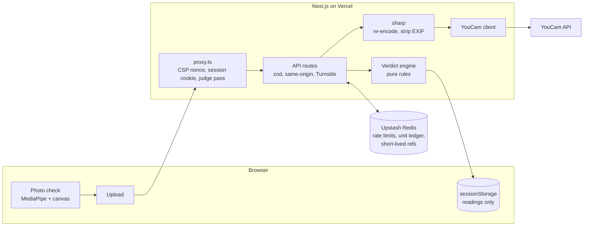

# CutCheck

**Know before you cut.** CutCheck uses the YouCam API to read your hair (type, length and frizz; you set density yourself). It then tells you which trending cuts will work on *your* hair and why, and shows you the cut, the outfit and the products to keep it.

**Live app:** https://cutcheck-snowy.vercel.app

Built for the YouCam API Skin AI & eCommerce VTO Hackathon (eCommerce VTO track). The longer story is in [docs/WRITEUP.md](docs/WRITEUP.md), and what we learned about the API is in [docs/API_NOTES.md](docs/API_NOTES.md).

## The problem

People pick haircuts from photos of other people's hair. Try-on apps make this worse: they will paste any cut onto anyone, whether or not that person's hair can hold it. The preview looks great, the real cut falls flat within a week, and the wrong products get bought.

CutCheck puts the analysis first and lets it decide what you can try on. It reads your hair, marks every cut ✓, ⚠ or ✗ with a plain reason, and only offers try-ons for cuts that can work. Then it carries the chosen cut into an outfit, a product kit and a card for your stylist.

## The journey

**Scan → Truth → See it → Wear it → Keep it**

1. **Scan.** You take three guided photos: straight on with your shoulders in frame, then turned left and right. Each photo is checked on your phone for size, light, blur and framing before anything is uploaded. A photo that fails the check never leaves the device.
2. **Truth.** Hair type, length and frizz come back with YouCam's own wording, and you set density yourself (the Density API rejected every photo angle we tried). You can correct any reading. Each cut for your audience (men, women or both, 19 in all) then gets a verdict with its reasons. A top pick sits above the board with a short script you can read to your barber, and every ✗ points to the closest cut that does work.
3. **See it.** Try a ✓ or ⚠ cut on your own photo with Hair Style VTO v2.1, keeping **your own hair colour**. The try-on also pastes the style's hair texture, so curly and coily hair only ever gets a curly model. Where a cut has no curly model, the app says so instead of showing you straight hair.
4. **Wear it.** With a separate consent, add a full-body photo and pick an occasion (everyday, interview or night out). You get an outfit and shoes, in masculine or feminine styles, next to the new cut.
5. **Keep it.** A product kit tied to your readings, a trim schedule, a demo-store cart, and a signed **stylist card** link with the cut notes and your readings. The card never contains a photo.

"Delete my data" removes everything in one tap and lists what was removed.

## How we decide

The verdicts come from written rules, not from an AI model. The same readings always give the same board. The rules live in [`data/cuts.json`](data/cuts.json) and [`src/lib/verdict/`](src/lib/verdict), and the app shows them on its "How we decide" page.

| Cut | For | Holds on | Density needed | Length needed | Frizz limit | Trim every |
|---|---|---|---|---|---|---|
| Textured crop | men | straight, wavy, curly, coily | low | short | any | 3 wks |
| Low taper fade | men | straight, wavy, curly, coily | low | buzz | any | 2 wks |
| Buzz cut | men | straight, wavy, curly, coily | low | buzz | any | 2 wks |
| Crew cut | men | straight, wavy, curly, coily | low | short | any | 3 wks |
| Curly top taper | men | curly, coily | medium | short | any | 3 wks |
| Afro | men | curly, coily | high | medium | any | 5 wks |
| Textured comma | men | straight, wavy | medium | medium | low | 4 wks |
| Wavy undercut | men | wavy, curly | medium | medium | any | 4 wks |
| Wolf cut | men, women | wavy, curly | medium | medium | any | 6 wks |
| Curtains | men, women | straight, wavy | medium | medium | medium | 6 wks |
| Blunt bob | women | straight, wavy | medium | medium | low | 6 wks |
| Sleek middle part | women | straight, wavy | medium | long | low | 8 wks |
| Side-part straight | women | straight | low | medium | low | 8 wks |
| Soft layers | women | straight, wavy | low | long | any | 10 wks |
| Shag | women | wavy, curly, coily | high | medium | any | 8 wks |
| Pixie | women | straight, wavy, curly, coily | low | short | any | 4 wks |
| Bouncy curls | women | curly, coily | low | medium | any | 10 wks |
| Curly bob | women | curly, coily | low | medium | any | 8 wks |
| Long spiral curls | women | curly, coily | medium | long | any | 12 wks |

- If the cut doesn't hold on your hair type, it's a ✗.
- Density one level short gives a ⚠ and adds a volume product. Two levels short is a ✗.
- Hair that's too short gives a ⚠ "grow first", with an estimate of how long it takes. Length alone never gives a ✗.
- Frizz above the cut's limit gives a ⚠ and adds an anti-frizz product to the kit.
- If a reading couldn't be made, the cut says "we need one more answer". It never guesses.
- The verdict is the worst finding, and every reason is listed.

These requirements are our own styling heuristics, written for CutCheck. They don't come from a cited barber or stylist source, which is why they're published in full so anyone can check them.

## YouCam APIs used

| Step | API | What it decides |
|---|---|---|
| Truth | AI Hair Type Detection (3 photos) | Which cuts can hold their shape |
| Truth | AI Hair Length Detection (front photo) | What's possible today, since a cut can only go shorter |
| Truth | AI Hair Frizziness Detection (3 photos) | Definition, and whether an anti-frizz product joins the kit |
| See it | AI Hair Style VTO v2.1, `hair_color: "src"` | The cut in your own colour |
| Wear it | AI Clothes VTO (outfit templates) | The occasion look |
| Wear it | AI Shoes VTO V3 | Shoes on the outfit |

## Architecture



- Every YouCam call happens on the server. The browser never sees the API key or a vendor URL.
- Each paid call reserves its units in a Redis ledger first, then settles to the real charge, so a failed task costs nothing.
- No route chains two vendor tasks. The browser drives the Look one step at a time (outfit, then shoes), so a slow step can't time out the whole request.

```
src/
  app/            pages and API routes (scan, verdict, tryon, look, kit, card, delete)
  copy/           every user-facing string, so the claims linter can check them
  lib/verdict/    the rules engine and growth estimates
  lib/youcam/     API client and response mappers
  lib/security/   sessions, rate limits, unit ledger, CSP, image sanitiser
  lib/client/     on-device photo checks and per-tab state
  proxy.ts        runs before every request
data/             cuts, products and looks (JSON, validated with zod at load)
tests/            Vitest unit tests and Playwright end-to-end tests
```

## Privacy and security

- **No images are stored on our servers.** Photos are handled in memory. Short-lived references (30 minutes) let try-ons work. Result images are served only to the session that created them, through 15-minute tokens.
- **Your readings stay in your browser tab** (sessionStorage). The selfie is kept only in page memory, and nothing goes in localStorage.
- **Perfect Corp** keeps uploads and results for up to 30 days. "Delete my data" asks YouCam to delete every task we started, along with its photos.
- **Protections:** a per-request nonce CSP, same-origin checks on every API POST, signed anonymous session cookies (there are no accounts), Turnstile on the routes that accept images, and no analytics.
- **No keys in git.** A gitleaks pre-commit hook and CI keep secrets out, and a separate check fails the build if a secret-named env var is used in client code.

## Budget and rate limits

The YouCam account has a small unit balance. A full real journey costs about 12 units (scan 6, try-on 2, outfit 2, shoes 2), so:

- **Public visitors get demo mode** (`PUBLIC_DAILY_UNIT_CAP=0`). The demo uses real readings captured once from the API, and labelled illustrations instead of photos.
- **Judges** unlock a separate reserve (`JUDGE_UNIT_CAP`) through the link in the Devpost testing instructions. The link sets a signed cookie and redirects to a clean URL.
- **Per-session limits:** 2 scans, 4 try-ons and 2 looks a day, plus an API-wide limit per IP.

## Honest limits

- **Small test set.** We tested on photos of our own team, not a broad panel of hair types, and we haven't measured reading accuracy.
- **Density is self-reported.** The Density API never returned a reading on any of our test photos.
- **No confidence scores.** The API doesn't return them, so every reading stays editable and we never show a made-up percentage.
- **Heuristic rules.** The verdicts aren't a barber's judgement, and a try-on is a visual preview, not a promise of the real cut.

## Run locally

Requires Node 22 and [gitleaks](https://github.com/gitleaks/gitleaks) (the pre-commit hook refuses commits without it).

```bash
npm install                  # also enables the pre-commit hook
cp .env.example .env.local   # fill in values locally; never commit them
npm run dev
```

Without a YouCam key the app uses a clearly labelled stand-in analyzer, which costs nothing. With a key, set `JUDGE_CODE` in `.env.local` and open `/?k=<your code>` to spend from the judge reserve. Otherwise the public cap of 0 sends you to demo mode.

## Checks

- `npm run check` runs the typecheck, lint, unit tests, the claims linter (it bans medical and overclaiming words in user-facing text) and the client-secret check.
- `npm run e2e` runs the Playwright journey, security and axe accessibility tests against a mock-only dev server, so it spends no units.
- CI also scans the full git history with gitleaks, runs `npm audit` and builds the app.

## Team

- [Banit Sriram Ambati](https://github.com/banitsriram)
- [raycon0009](https://github.com/raycon0009)

## Credits

Cut drawings, product icons and demo illustrations are our own (`public/`), and the product brands are fictional. Style photos are YouCam hairstyle templates (`public/photos/`). Outfits are YouCam templates; the shoe photos are our own.

*Cosmetic styling guidance, not medical advice.*
